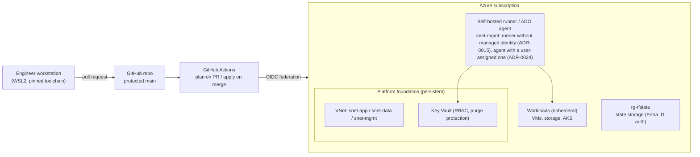

# Azure Platform Engineering — Regulated Pharma Reference Platform

A reference implementation of an enterprise Azure platform for a regulated (GxP/SOX-style)
pharmaceutical workload, designed and built to production standards: infrastructure as code,
pull-request change control, identity-based access and documented decisions.

> **Scope and framing.** The company in the scenario is fictional. This is a reference platform
> I designed and built to show how such a platform should be engineered; it is not a production
> system and contains no employer code, systems or data.

## 1. Scenario and requirements

A mid-size pharmaceutical company runs validated (GxP) and financially controlled (SOX)
applications on Azure. Its platform team must provide:

- **Traceable change** — every change is reviewed, recorded and reversible; no manual changes
  in the portal.
- **No standing secrets** — automation authenticates with federated identity; unavoidable
  secrets live in Key Vault.
- **Reproducibility** — any environment can be rebuilt from this repository alone.
- **Separation of environments** — dev and prod isolated by resource group, RBAC scope and tags.
- **Cost control** — persistent foundation at near-zero cost; workloads are ephemeral.

## 2. Target architecture

This is the target design; section 7 shows what is built today.

## 3. Repository layout

| Path | Purpose |
|---|---|
| `bootstrap/` | Idempotent scripts for what Terraform cannot create for itself (repository settings, state backend, CI identities) |
| `modules/` | Reusable Terraform modules, never applied directly, versioned by tag |
| `platform/` | Root modules: persistent (foundation network, security, cost, agent identity) and ephemeral (self-hosted runner, Azure DevOps agent) |
| `workloads/` | Ephemeral root modules (apply → verify → destroy) |
| `ansible/` | Configuration management: roles, inventories, playbooks |
| `pipelines/` | Azure DevOps pipelines (auth check, Terraform validate, agent check, multi-stage Terraform deploy and shared templates) |
| `docs/adr/` | Architecture Decision Records |
| `docs/runbooks/` | Operational runbooks for every persistent component |
| `scripts/` | Local helper scripts and the repository consistency checks (Terraform version, shared boot block) |
| `.github/workflows/` | CI workflows (`validate.yml` and `plan.yml` on pull requests; `apply.yml` on merge, on the self-hosted runner) |

## 4. Deploying from zero

1. Build the workstation: `docs/runbooks/workstation-setup.md`.
2. Clone the repository and run `pre-commit install` (hooks are per clone).
3. Apply repository settings: `bootstrap/github-repo-settings.sh`.
4. Create the state backend: `bootstrap/state-backend.sh`.
5. Create the CI identities with OIDC federation: `bootstrap/github-oidc.sh` (GitHub Actions) and `bootstrap/ado-oidc.sh` (Azure DevOps).
6. Apply the persistent roots through pull requests: `platform/foundation/hub`, then the spokes (`dev`, `prod`), `platform/security`, `platform/cost` and `workloads/storage-demo/prod`. Roots listed in `SKIP_ROOTS` of `.github/workflows/apply.yml` (`platform/agent-identity`, `platform/ado-agent`, `platform/runner` and the two dev demo workloads) are applied by hand; the runner and the agent are ephemeral and are destroyed after use (ADR-0015, ADR-0024).

## 5. Security model

- Identity first: OIDC for GitHub Actions, workload identity federation for Azure DevOps,
  managed identity for VMs, Entra ID auth for Terraform state (ADR-0002).
- `main` accepts changes only through pull requests; nobody can bypass the ruleset (ADR-0003).
- Every pull request must pass the `validate-gate` check (format, validate and tflint on every Terraform
  directory, with no cloud credentials) before it can merge (ADR-0012).
- Pre-commit hooks on every commit: formatting, validation, tflint, yamllint and `gitleaks`
  secret scanning.
- Terraform state and plan files are treated as secrets and never committed.
- See [SECURITY.md](SECURITY.md).

## 6. Decisions

| ADR | Decision |
|---|---|
| [0001](docs/adr/0001-record-architecture-decisions.md) | Record architecture decisions |
| [0002](docs/adr/0002-secrets-and-identity.md) | Secrets and identity |
| [0003](docs/adr/0003-repository-governance.md) | Repository visibility and change control on `main` |
| [0004](docs/adr/0004-subscription-and-environment-layout.md) | Subscription and environment layout |
| [0005](docs/adr/0005-remote-state-backend.md) | Remote state backend |
| [0006](docs/adr/0006-storage-module-and-environment-roots.md) | Storage module and per-environment root modules |
| [0007](docs/adr/0007-network-topology.md) | Network topology: minimal hub and per-environment spokes |
| [0008](docs/adr/0008-linux-vm-module-and-workload-root.md) | Linux VM module and the vm-demo workload root |
| [0009](docs/adr/0009-storage-network-access.md) | Storage network access (firewall and allow-lists) |
| [0010](docs/adr/0010-platform-key-vault.md) | Platform Key Vault (authorization, network access, protection) |
| [0011](docs/adr/0011-cost-budget.md) | Subscription cost budget in Terraform |
| [0012](docs/adr/0012-validate-workflow.md) | Validate workflow for every Terraform directory |
| [0013](docs/adr/0013-github-oidc-identities.md) | GitHub Actions identities for Azure (OIDC, plan and apply) |
| [0014](docs/adr/0014-plan-on-pull-request.md) | Plan on pull request for every Terraform root |
| [0015](docs/adr/0015-github-runner-and-apply-on-merge.md) | Self-hosted GitHub Actions runner and apply on merge |
| [0016](docs/adr/0016-ansible-practice-target.md) | Ansible practice target outside the platform network |
| [0017](docs/adr/0017-handler-failure-policy.md) | Handler failure policy for playbooks (`force_handlers`) |
| [0018](docs/adr/0018-ansible-role-layout.md) | Ansible role layout, entry playbook and variable policy |
| [0019](docs/adr/0019-ansible-azure-dynamic-inventory.md) | Azure dynamic inventory, dependency pinning and inventory identity |
| [0020](docs/adr/0020-ansible-vault-strategy.md) | Ansible Vault strategy (password in Key Vault, client script, rotation) |
| [0021](docs/adr/0021-ansible-lint-and-molecule.md) | ansible-lint (production profile) and Molecule tests for Ansible roles |
| [0022](docs/adr/0022-ado-azure-identity.md) | Azure DevOps identity for Azure (workload identity federation, manual service connection) |
| [0023](docs/adr/0023-ado-terraform-validate-pipeline.md) | Azure DevOps Terraform validate pipeline (pinned image, verified download, validate-level scope) |
| [0024](docs/adr/0024-ado-agent-identity.md) | Self-hosted Azure DevOps agent: identity, secret access and module structure |
| [0025](docs/adr/0025-terraform-version-source-and-drift-checks.md) | One source for the Terraform version, and checks for text that is written twice |
| [0026](docs/adr/0026-ado-terraform-deploy-pipeline.md) | Azure DevOps multi-stage Terraform pipeline: Build, Plan and a manual Deploy, two identities, one shared sign-in template |
| [0027](docs/adr/0027-ado-environment-approval.md) | An approval check on the Azure DevOps environment that the Deploy stage targets |

## 7. Status

| Component | Status |
|---|---|
| Repository governance, quality gates, ADRs | ✅ in place |
| Terraform state backend | ✅ in place |
| Storage module (hardened baseline) with dev/prod roots | ✅ in place |
| Foundation network, Key Vault and cost budget | ✅ in place |
| CI: validate workflow on every Terraform directory, required check on `main` | ✅ in place |
| CI: plan on pull request, read-only OIDC identity | ✅ in place |
| CD: apply on merge, self-hosted runner, `production` approval | ✅ in place; the runner is ephemeral and is rebuilt before an apply run (first apply run succeeded 2026-10-16) |
| Configuration management (Ansible): role, dynamic inventory, Vault, lint and Molecule | ✅ in place, tested against a throwaway sandbox target (ADR-0016 to 0021) |
| Azure DevOps: Azure identity, Terraform validate pipeline, self-hosted agent and its check pipeline | ✅ in place; the agent is ephemeral (ADR-0022 to 0024) |
| Repository consistency checks (Terraform version, shared boot block) | ✅ in place (ADR-0025) |
| Azure DevOps multi-stage Terraform pipeline (Build, Plan, manual Deploy) | ✅ in place; Deploy waits for an approval on environment `pipeline-demo-dev` (ADR-0027); no branch check yet |
| Containers (AKS), Azure Firewall and routing, private endpoints, Azure Policy | ⬜ planned |
